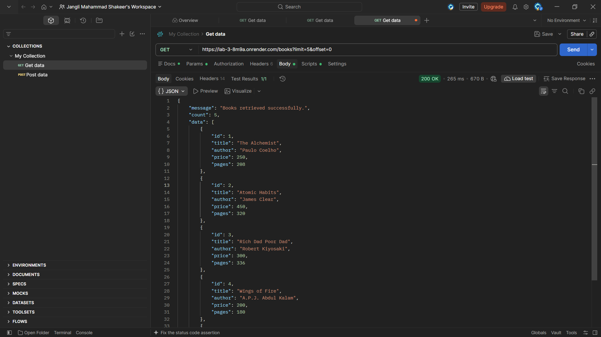

# Lab 3 – REST API, Query Parameters, Validation and Debugging

## Project Details

- **Name:** Anchetti Vignan
- **Registration Number:** 252U1R5007
- **Section:** S-10
- **Department:** Artificial Intelligence and Data Engineering
- **University:** Aurora Higher Education and Research Academy
- **Course:** Backend Development Fundamentals (BDF)
- **Lab:** Lab 3 – REST API, Query Parameters, Validation and Debugging
- **Faculty:** Sai Shiva Teja Sir

## Deployment URL

- **Render Live URL:** [https://backend-lab-3-37gu.onrender.com/books](https://backend-lab-3-37gu.onrender.com/books)
- **Primary Service URL:** [https://backend-lab-3-37gu.onrender.com](https://backend-lab-3-37gu.onrender.com)

---

## Project Description

This project implements a complete RESTful API using **Node.js**, **Express.js**, and **SQLite**. It builds upon the CRUD foundation from Lab 2 and turns it into a full-featured REST API with:
- Partial title searching using SQL `LIKE ?`
- Dynamic column sorting (`order_by`) and directions (`ASC` / `DESC`)
- Pagination via `limit` and `offset`
- Price filtering with `min_price` and `max_price`
- Robust request body validation returning `400 Bad Request` with clear messages
- Proper HTTP status codes (`200 OK`, `201 Created`, `400 Bad Request`, `404 Not Found`, `500 Internal Server Error`)
- Unified JSON error and response formats
- SQLite GLIBC rebuild compatibility for frictionless cloud deployment on **Render**

The database contains 10 curated book records with details including `id`, `title`, `author`, `price`, and `pages`.

---

## Technologies Used

- **Node.js** (v18+)
- **Express.js** (v4.x)
- **SQLite3 & SQLite** (Promise-based asynchronous driver)
- **JavaScript (ES6+)**
- **Postman** (API testing & collection)
- **Render** (Cloud Web Service deployment)
- **Visual Studio Code / Antigravity**

---

## Project Structure

```text
Backend lab 3/
├── server.js                          # Express application with all REST routes & validation
├── books.db                           # SQLite database file containing 10 book records
├── package.json                       # Dependencies, scripts & Render postinstall build hook
├── .gitignore                         # Git ignore configuration
├── README.md                          # Full project documentation & screenshots
│
├── screenshots/                       # Postman & deployment verification screenshots
│   ├── render deployment.png          # Cloud live deployment on Render
│   ├── GET All Books.png              # GET /books
│   ├── GET Book by ID.png             # GET /books/1
│   ├── Search Books.png               # GET /books?search_q=The
│   ├── Sorting Ascending.png          # GET /books?order_by=price&order=ASC
│   ├── Sorting Descending.png         # GET /books?order_by=price&order=DESC
│   ├── Pagination.png                 # GET /books?limit=5&offset=0
│   ├── Price Filtering.png            # GET /books?min_price=200&max_price=350
│   ├── Combined Query.png             # Search + Filter + Sort + Limit
│   ├── POST Successful Request.png    # POST /books (201 Created)
│   ├── POST Validation Error.png      # POST /books missing title (400 Bad Request)
│   ├── PUT Update Request.png         # PUT /books/1 (200 OK)
│   └── DELETE Request.png             # DELETE /books/1 (200 OK)
│
├── debugging-exercise/                # Task 7 Faculty Handout Debugging Solution
│   ├── broken_server.js               # Faculty handout containing the 4 classic defects
│   ├── fixed_server.js                # Fully corrected server implementation
│   └── DEBUGGING_WALKTHROUGH.md       # Step-by-step diagnostic breakdown
│
├── postman_collection.json            # Importable Postman Collection v2.1.0
└── test-api.js                        # Automated test runner (18/18 passing)
```

---

## Installation and Setup

### 1. Clone the repository
```bash
git clone <your-github-repo-url>
cd "Backend lab 3"
```

### 2. Install dependencies
```bash
npm install
```

### 3. Start the development server
```bash
npm run dev
```
*(Or `npm start` for standard mode).*

The server runs locally at:
```text
http://localhost:3000
```

### 4. Run automated test suite
```bash
npm test
```
All 18 automated tests will run and report status in your terminal.

---

## API Endpoints

| HTTP Method | Endpoint | Description | Expected Status |
| :--- | :--- | :--- | :--- |
| **GET** | `/books` | Retrieve all books (with search, sort, filter, pagination) | `200 OK` |
| **GET** | `/books/:bookId` | Retrieve a specific book by ID | `200 OK` / `404 Not Found` |
| **POST** | `/books` | Add a new book with validation | `201 Created` / `400 Bad Request` |
| **PUT** | `/books/:bookId` | Update an existing book | `200 OK` / `404 Not Found` |
| **DELETE**| `/books/:bookId` | Delete a book by ID | `200 OK` / `404 Not Found` |

---

## Query Parameters (`GET /books`)

### 1. Search Books
```text
GET /books?search_q=The
```
Searches for books with a partial match in the `title` column using SQL `LIKE %search_q%`.

### 2. Sorting
- **Ascending order:**
  ```text
  GET /books?order_by=price&order=ASC
  ```
- **Descending order:**
  ```text
  GET /books?order_by=price&order=DESC
  ```
Allowed columns: `id`, `title`, `author`, `price`, `pages`.

### 3. Pagination
- **First 5 books:**
  ```text
  GET /books?limit=5&offset=0
  ```
- **Next 5 books:**
  ```text
  GET /books?limit=5&offset=5
  ```

### 4. Price Filtering
```text
GET /books?min_price=200&max_price=350
```
Filters books with prices between ₹200 and ₹350.

### 5. Combined Query
```text
GET /books?search_q=The&min_price=200&max_price=500&order_by=price&order=ASC&limit=3&offset=0
```
Applies partial search, price range filter, sorting, and pagination simultaneously.

---

## Database Records

The database contains the following 10 pre-seeded books:

| ID | Title | Author | Price (₹) | Pages |
|---:|---|---|---:|---:|
| 1 | The Alchemist | Paulo Coelho | 250 | 208 |
| 2 | Atomic Habits | James Clear | 450 | 320 |
| 3 | Rich Dad Poor Dad | Robert Kiyosaki | 300 | 336 |
| 4 | Wings of Fire | A.P.J. Abdul Kalam | 200 | 180 |
| 5 | Ikigai | Hector Garcia | 350 | 194 |
| 6 | Think Like a Monk | Jay Shetty | 400 | 288 |
| 7 | Deep Work | Cal Newport | 500 | 304 |
| 8 | The Power of Now | Eckhart Tolle | 280 | 236 |
| 9 | Zero to One | Peter Thiel | 320 | 210 |
| 10 | The 5 AM Club | Robin Sharma | 380 | 336 |

---

## Request Body for POST and PUT

In Postman, select **Body → raw → JSON**.

### POST – Add a New Book (`POST /books`)
```json
{
  "title": "C++ Programming",
  "author": "Bjarne Stroustrup",
  "price": 600,
  "pages": 450
}
```
**Expected Status:** `201 Created`  
**Response:**
```json
{
  "message": "Book created successfully.",
  "data": {
    "id": 11,
    "title": "C++ Programming",
    "author": "Bjarne Stroustrup",
    "price": 600,
    "pages": 450
  }
}
```

### PUT – Update an Existing Book (`PUT /books/1`)
```json
{
  "title": "The Alchemist Updated",
  "author": "Paulo Coelho",
  "price": 350,
  "pages": 220
}
```
**Expected Status:** `200 OK`  
**Response:**
```json
{
  "message": "Book updated successfully.",
  "data": {
    "id": 1,
    "title": "The Alchemist Updated",
    "author": "Paulo Coelho",
    "price": 350,
    "pages": 220
  }
}
```

---

## HTTP Status Codes

| Status Code | Meaning | When Returned in This API |
| :--- | :--- | :--- |
| **200 OK** | Success | Retrieving records (`GET`), updating (`PUT`), deleting (`DELETE`). |
| **201 Created** | Created | Successfully creating a new book (`POST`). |
| **400 Bad Request**| Client Error | Missing title/author, non-numeric price, invalid sort column, inverted price range. |
| **404 Not Found** | Missing | Target book ID does not exist, or unhandled URL route. |
| **500 Internal Error**| Server Error | Unexpected database connection failure. |

---

## 📸 Screenshots Evidence

### 1. Render Cloud Deployment


### 2. GET All Books (`GET /books`)


### 3. GET Book by ID (`GET /books/1`)


### 4. Search Books (`GET /books?search_q=The`)


### 5. Sorting Ascending (`GET /books?order_by=price&order=ASC`)


### 6. Sorting Descending (`GET /books?order_by=price&order=DESC`)


### 7. Pagination (`GET /books?limit=5&offset=0`)


### 8. Price Filtering (`GET /books?min_price=200&max_price=350`)


### 9. Combined Query (`Search + Filter + Sort + Pagination`)


### 10. POST Successful Request (`201 Created`)


### 11. POST Validation Error (`400 Bad Request`)


### 12. PUT Update Request (`200 OK`)


### 13. DELETE Request (`200 OK`)


---

## 🛠️ Error Handling and Debugging (Task 7 Walkthrough)

During API development and cloud deployment, common backend bugs were investigated, diagnosed, and resolved:

### 1. Port Already in Use (`EADDRINUSE`)
- **Error:** `Error: listen EADDRINUSE: address already in use :::3000`
- **Cause:** Another process was already occupying port 3000.
- **Solution:** Configured `const PORT = process.env.PORT || 3000` and terminated conflicting processes with `taskkill /PID <PID> /F` or stopped running servers via `Ctrl + C`.

### 2. Wrong Import Path (`MODULE_NOT_FOUND`)
- **Error:** `Error: Cannot find module '../database'`
- **Cause:** Typo in relative path to the database module.
- **Solution:** Corrected relative require path to point to the actual database file.

### 3. SQLite Table Not Found (`no such table`)
- **Error:** `SQLITE_ERROR: no such table: books`
- **Cause:** Query used plural `books` while table was named `book`.
- **Solution:** Standardized SQL statements to use `FROM book` and ensured `CREATE TABLE IF NOT EXISTS book` executes before starting the listener.

### 4. Missing Await in Asynchronous Operations
- **Error:** Endpoint returned `{}` or `books.map is not a function`.
- **Cause:** `db.all()` returns a Promise. Without `await`, JavaScript serializes the pending Promise before the database finishes resolving rows.
- **Solution:** Added `await` before all database queries: `const books = await db.all(sql, values);`.

### 5. Render Deployment Error (SQLite GLIBC Compatibility)
- **Error:** `GLIBC_2.38 not found`
- **Cause:** Precompiled SQLite3 binary compiled against different glibc than Render Linux environment.
- **Solution:** Added a `postinstall` script to `package.json`:
  ```json
  "scripts": {
    "postinstall": "npm rebuild sqlite3 --build-from-source"
  }
  ```
  Render automatically invokes this script during build, building sqlite3 specifically for the Linux target container.

---

## 🎓 Viva Questions & Answers

### 1. Query parameter vs Path parameter?
- **Path parameter (`/books/:bookId`):** Identifies a specific resource instance. Crucial for addressing individual items.
- **Query parameter (`/books?search_q=The&order=ASC`):** Optional modifiers that shape how resources are returned (filtering, sorting, searching, pagination) without changing resource identity.

### 2. What does stateless mean in REST?
- Every client request contains all the information needed for the server to process it. The server does not store client session context between requests, enabling horizontal scalability.

### 3. Which status code for bad input vs a missing record?
- **400 Bad Request:** Syntactically malformed requests, missing required fields, or validation failures (e.g. non-numeric price).
- **404 Not Found:** Syntactically correct request, but the requested resource ID does not exist in the database.

### 4. Why await the database call?
- SQLite queries perform asynchronous non-blocking I/O and return a Promise. Without `await`, the execution advances synchronously and returns an unfulfilled Promise object `{}` instead of the query results.

### 5. What is SQL injection and how do placeholders prevent it?
- **SQL Injection:** Occurs when malicious user input is concatenated directly into SQL queries.
- **Prevention:** Parameterized queries with `?` placeholders ensure the database parses query commands first, and treats user inputs strictly as literal string/numeric values.

### 6. When is PUT used instead of POST?
- **POST:** Used to create a new resource (server assigns ID, usually non-idempotent).
- **PUT:** Used to update or replace an existing resource at a known URI (idempotent; executing multiple times produces the identical outcome).

---

## ☁️ Step-by-Step Render Deployment Guide

To deploy this project live on Render:

1. **Push your code to GitHub:**
   ```bash
   git init
   git add .
   git commit -m "Complete Lab 3 REST API"
   git remote add origin https://github.com/<your-username>/lab-3.git
   git branch -M main
   git push -u origin main
   ```
2. **Go to [Render.com](https://render.com/)** and log in.
3. Click **New +** → **Web Service**.
4. Connect your GitHub repository (`lab-3`).
5. Configure the service:
   - **Name:** `lab-3` (or any unique name)
   - **Language:** `Node`
   - **Branch:** `main`
   - **Build Command:** `npm install` *(the `postinstall` script in package.json will rebuild sqlite3 automatically)*
   - **Start Command:** `npm start`
   - **Instance Type:** `Free`
6. Click **Deploy Web Service**.
7. Once deployed, Render provides your live URL (e.g. `https://your-app.onrender.com/books`). Copy and paste it at the top of your `README.md`!

---

**End of Lab 3**
